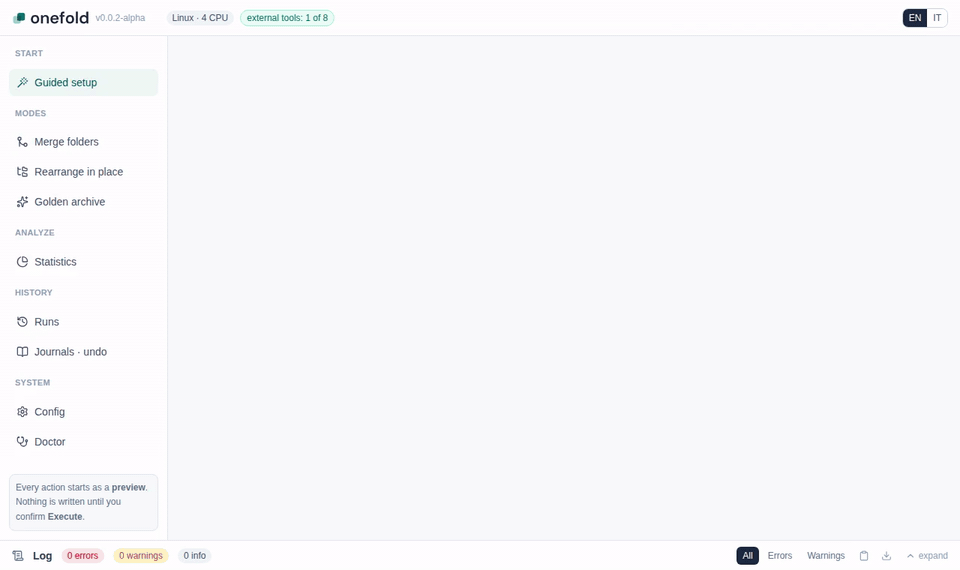
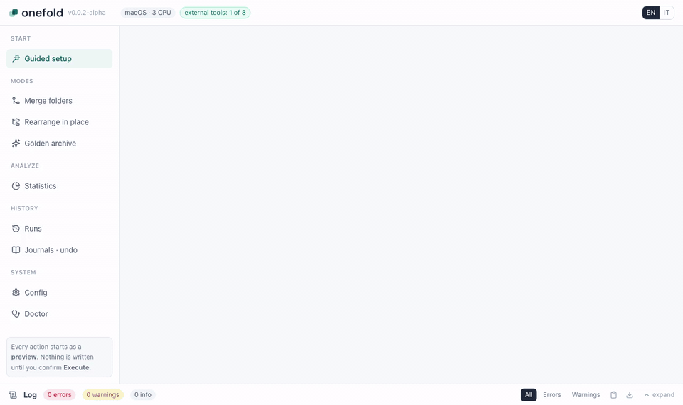
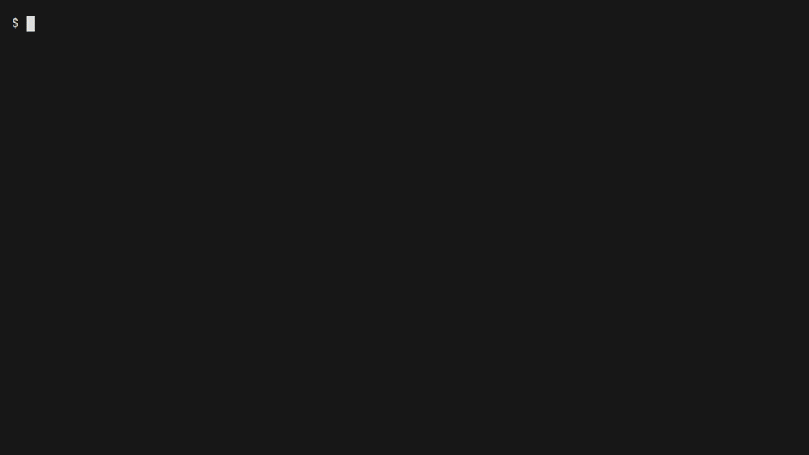

<p align="center">
  <picture>
    <source media="(prefers-color-scheme: dark)" srcset="assets/brand/onefold-logo-dark.svg">
    
  </picture>
</p>

<p align="center"><b>One copy of every file you own, under a name you can predict.</b></p>

<p align="center">
  <a href="https://github.com/mauriziofonte/onefold/actions/workflows/ci.yml"></a>
  <a href="https://github.com/mauriziofonte/onefold/releases"></a>
  <a href="LICENSING.md"></a>
  <a href="https://pkg.go.dev/github.com/mauriziofonte/onefold"></a>
  <a href="https://scorecard.dev/viewer/?uri=github.com/mauriziofonte/onefold"></a>
</p>

Your files are spread over a laptop, an old PC, a phone backup, two external drives and a NAS. The same photo exists five times under five names; some copies were resized, some renamed by tools that added `(1)` or a date in front. onefold finds what is the same, keeps one copy of every distinct thing and puts it under a predictable name, without ever touching the originals unless you ask.



One static binary for Linux (amd64, arm64), macOS (Apple Silicon, Intel) and Windows (amd64), with a local GUI and a full command line. Current version: 0.0.2-alpha, an early pre-release ([CHANGELOG.md](CHANGELOG.md)).

## Contents

- [What it does](#what-it-does)
- [Safety](#safety)
- [Install](#install)
- [Quick start](#quick-start)
- [The GUI](#the-gui)
- [Merge folders](#merge-folders)
- [Empty the sources after a merge](#empty-the-sources-after-a-merge)
- [Reorganize a folder in place](#reorganize-a-folder-in-place)
- [Statistics](#statistics)
- [Photo and video archive](#photo-and-video-archive)
- [Configuration](#configuration)
- [Scheduled jobs](#scheduled-jobs)
- [Optional tools](#optional-tools)
- [How many files](#how-many-files)
- [Windows notes](#windows-notes)
- [Documentation](#documentation)
- [Build from source](#build-from-source)
- [Contributing](#contributing)
- [License](#license)

## What it does

| Mode | You get | Commands |
|---|---|---|
| Merge folders | one folder holding every distinct file of several folders exactly once, named by a pattern you choose | `merge`, then optionally `purge-sources` |
| Reorganize in place | the same folder, files renamed and moved to a pattern, exact duplicates removed | `rearrange` |
| Statistics | what fills a disk or a set of folders (file types, folders, years, sizes) and how much space duplicates waste, read-only | `stats` |
| Clean up duplicates | one copy of each group of identical files stays; the others go to the Recycle Bin / Trash, become hard links or clones of it, or are listed in a script you run | `dedupe` |
| Photo and video archive | a "golden" tree with one file per photo or video, canonical names such as `PICTURES/JPG/2021/IMG_20210506_070809.jpg`, the capture date and device written into each copy | `catalog`, `plan`, `apply`; later `golden-index`, `match` |

Around them: lists of look-alike photos and same-text documents to review (`similar`), a verified list of leftover copies with a deletion script you run yourself (`reclaim`), a copy for a disk you put away with a later integrity check (`backup`), plain-text copies of documents (`export-text`), transfer helpers (`push` over SFTP, `seed` scripts for rsync or robocopy).

How it decides that two files are the same:

- exact copies: a fast sampled hash, always confirmed on the full content before anything is skipped or deleted;
- photos and videos: also the same shot saved differently (a resized or re-encoded copy, the HDR and normal frames of one capture). The sharpest version wins; the others are recorded, never deleted by the planner;
- distinct things stay distinct: two photos taken in the same second by different phones, the RAW and the JPG of one shot, an edited photo and its original.

## Safety

- **Sources are read-only.** Three operations delete or replace files, only when you ask for them: `rearrange` deletes duplicates confirmed on their full content, `purge-sources` deletes merged input files whose copy in the output was read again and found equal, and `dedupe` sends extra copies to the Recycle Bin / Trash or replaces them by links or clones of the copy that stays, after reading both again. All are dry runs until you add `-execute`, and all write a journal first.
- **Nothing is overwritten.** Every file is written under a temporary name, verified, and only then given its final name with a rename that refuses to replace an existing file.
- **Run it again to finish.** Every command is idempotent: an interrupted run, a power cut, a closed laptop lid are fixed by running the same command again.
- **Preview first.** Commands that copy, move or delete files (`merge`, `rearrange`, `purge-sources`, `dedupe`, `apply`, `backup`) do nothing without `-execute`; the GUI always shows a preview and executes exactly what you reviewed.
- **Local only.** The GUI listens on 127.0.0.1, behind a one-time session link; its state folder is readable by you only. Nothing leaves your computer unless you ask: `push` uploads to your own server, `onefold tools install` downloads the optional tools.

## Install

Download the binary for your system from the [releases page](https://github.com/mauriziofonte/onefold/releases) and check it:

```bash
sha256sum -c SHA256SUMS --ignore-missing         # Linux, Windows (Git Bash)
shasum -a 256 -c SHA256SUMS --ignore-missing     # macOS
```

| System | File |
|---|---|
| Windows 10/11 x64 | `onefold-windows-amd64.exe` |
| Linux x64 (also WSL, most NAS) | `onefold-linux-amd64` |
| Linux ARM64 (Raspberry Pi 4/5, ARM NAS) | `onefold-linux-arm64` |
| macOS Apple Silicon (M1 and later) | `onefold-darwin-arm64` |
| macOS Intel | `onefold-darwin-amd64` |
| macOS, as an app for Finder, the Dock and Launchpad | `onefold-darwin-arm64-app.zip` (Apple Silicon), `onefold-darwin-amd64-app.zip` (Intel) |

Nothing to install: put the file anywhere (rename it to `onefold.exe` or `onefold` if you like). The optional helper tools are covered [below](#optional-tools).

Releases after v0.0.2-alpha also carry Linux packages, which add a menu entry and the icon: `sudo apt install ./onefold-linux-amd64.deb`, `sudo dnf install ./onefold-linux-amd64.rpm`, or `sudo apk add --allow-untrusted onefold-linux-amd64.apk` (arm64 alike). Every such release has a CycloneDX SBOM per binary (`<binary>.cdx.json`) and a build provenance attestation you can check with `gh attestation verify onefold-linux-amd64 --repo mauriziofonte/onefold`; the release workflow also builds everything twice and requires the same bytes. A Homebrew tap, a Scoop bucket and a winget entry are prepared but not published yet ([packaging/README.md](packaging/README.md)).

On macOS the binaries are not notarized (that needs a paid Apple Developer account), so the first start is blocked by Gatekeeper. Either remove the download mark once, from Terminal:

```bash
chmod +x onefold-darwin-arm64
xattr -d com.apple.quarantine onefold-darwin-arm64
./onefold-darwin-arm64 gui
```

or run it once, then allow it in System Settings > Privacy & Security ("Allow Anyway") and run it again. On macOS the GUI opens in your default browser (`onefold gui` from Terminal).

The app zip holds `onefold.app`: unzip it, move it to Applications and open it. The first time Gatekeeper stops it the same way: allow it in System Settings > Privacy & Security ("Open Anyway"), or run `xattr -dr com.apple.quarantine /Applications/onefold.app` once. Opening the app opens the GUI in the browser; it has no Dock icon and ends by itself two minutes after the last onefold page is closed (a running job keeps it alive). The command line is inside it too: `/Applications/onefold.app/Contents/MacOS/onefold help`.

## Quick start

**With the GUI.** On Windows, double-click `onefold.exe`. Elsewhere run `onefold gui`. The guided setup asks what you want to do, scans your folders and shows what would happen to a sample of your files before anything is written.

**From a terminal**, merging an old disk and a temporary folder into `D:\FILES`:

```bat
:: preview: lists what would be copied, writes nothing
onefold.exe --input D:\FILES --input E:\old-disk --input D:\TMP --output D:\FILES

:: do it
onefold.exe --input D:\FILES --input E:\old-disk --input D:\TMP --output D:\FILES --execute
```

`onefold help` lists every command and flag, `onefold naming` the naming patterns, `onefold doctor` what your system offers.

## The GUI

On Windows a window opens (the console closes); without the WebView2 runtime, the default browser opens instead. From a terminal, on any system: `onefold gui`. The link it prints opens a session once, within 5 minutes; run `onefold gui` again for a new link to the same running instance.

The same merge recorded on the Windows and macOS machines of the CI (the window is the browser page; the paths are the runner's):

| Windows | macOS |
|---|---|
|  |  |

- **Guided setup**: the first page on a fresh install, and a button in every mode. It asks what you want to do (bring folders together, tidy up a folder, a photo and video archive from several computers, only find duplicates), scans the folders quickly (names and sizes only) and shows, after every answer, what would happen to a sample of your files, computed by the real engine. At the end it fills the right mode and starts its preview; it also shows the equivalent command (PowerShell) and saves the answers as a recipe.
- **Every mode of the command line**: merge, rearrange, golden archive, statistics, journals and undo, configuration, tool downloads.
- **Statistics**: pick whole volumes from their cards, or folders, and see what fills them: a family chart (photos, videos, documents...) to click for its categories, extensions and largest files, a folder map to zoom into, bytes per year and per size band, and the duplicates: how much space they waste, by family and extension, the groups of copies with every path, and the pairs of folders sharing the most files, each with a button that opens Merge on those two folders. The charts fill in live while the scan runs.
- **Preview, then execute**: Execute runs exactly what the preview showed and asks you to type the number of files a rearrange or a source purge will delete.
- **Light or dark** like your system, readable with a screen reader: every chart has its numbers in a table below it, and each page passes the WCAG 2.1 AA checks of axe-core in both themes (the end-to-end test runs them).
- **A notification when a job ends** while onefold is not the window in front: turn it on in Config (the browser asks once for the permission; nothing leaves the computer).
- **Naming per kind of file**: for photos and images, videos, documents, music, archives and everything else you pick a layout and what happens to the file name (normalized, clean, original, or with the name of a folder in front, like `[merge] posta.mbox`). The filters show every rule; the preview lists the files left out with the reason. "Export settings" saves them for `onefold merge -settings FILE`; "Copy command" gives the same run as a command line.
- **Plan review**: after a preview the Plan tab lists every file (or groups them by folder, with counts and sizes), sorted and filtered by extension. Leave out a file, a folder or a pattern such as `*.data` from there: the plan updates at once, without scanning the disks again. Folders that look like driver or installer packages are pointed out, with a button to leave them all out.
- **After a merge**, "Purge the sources" deletes from the input folders the files that are now in the output (with a preview, the typed count, and the Recycle Bin or Trash as an option).
- **Long runs**: progress is always visible at the top, errors and warnings in the log panel at the bottom. Pause, resume or stop at any time. Runs are saved: one cut by a stop or by switching the computer off is listed under Runs and resumes where it was.
- **Six languages**: English, Italian, Spanish, French, German and Brazilian Portuguese (switch at the top right; the default follows the browser language). Folders and options are remembered. [TRANSLATING.md](TRANSLATING.md) says how to add or improve one.
- **Config page**: the owner, comment and video language written into photo and video copies, the time zone, how dates in file names are read, and on Windows a switch for the diagnostic log.

## Merge folders

Fold several folders into one, keeping every distinct file exactly once. The output can be one of the inputs.



```bat
:: preview
onefold.exe --input D:\FILES --input E:\old-disk --output D:\FILES

:: do it
onefold.exe --input D:\FILES --input E:\old-disk --output D:\FILES --execute
```

- Files already in the output are never moved, renamed, overwritten or deleted. Inputs are never modified.
- A file is skipped only if the same bytes are already in the output (checked on the full content).
- New files go to `<EXT>\<YEAR>\<original name>` (undated: `UNDATED`); a name already taken gets `_01`, `_02`...
- Every copy is written to a temporary file, read back and verified, and only then given its final name. If the run is interrupted, run it again.
- The output keeps a `.onefold` folder with a cache: the second run on the same folders takes seconds.

Choosing what and how:

- **Naming per family** with `-name`: `-name all=ext-year+prefix` puts the folder of each file in front of its name (`TXT\2021\[Desktop] nota.txt`), `-name doc=documents+prefix:2` uses the folder two levels up for documents, `-name img=photo-timestamp` renames photos by date. Families: `img` (photos and images), `video`, `doc`, `music`, `arch` (archives), `rest` (everything else, also unknown extensions and files without one). `-naming` takes any preset or your own template (`onefold naming` lists them).
- **By place**: `-naming places` files photos and videos by where they were taken, `2021\Italy\Rome\IMG_1234.jpg` (`Italia` with `onefold config set names-language it`); any template can use `{country}`, `{country-code}` and `{city}`. The place is read from the GPS position in each file and looked up in a table of 47,000 cities inside onefold: nothing is sent anywhere. The city is the nearest one of at least 5000 people within 30 km, a large city winning over a small town next to its centre; without a city in reach the folder is `Unknown place`. Near a border the country can be the neighbour's. `catalog -places` keeps the position in a manifest (off by default, so manifests hold no location).
- **Left out by default**: empty files, hidden files, system, cloud-sync and developer folders, OS droppings (`Thumbs.db`, `desktop.ini`), temporary and partial files (`.tmp`, downloads in progress, Office `~$` lock files), shortcuts (`.lnk`, `.url`) and, on Windows and macOS, cloud files that are not on this computer (OneDrive, iCloud Drive, Dropbox "online-only": reading them would download them; `-keep online-only` merges them). Each rule has a name: `-keep shortcuts` keeps them, `-skip ...` turns one on. `-keep-dotfiles` also merges hidden and empty files (an empty file counts once per name: `.nomedia`, `__init__.py`). `--list` shows every file left out and why.
- **Exclusions**: `-exclude-path D:\COMPS\COMP1\DRIVERS` leaves out a file or a folder, `-exclude-glob "*.data"` or `-exclude-glob "**/node_modules/**"` a pattern (both repeatable). The summary points out folders that look like driver or installer packages and prints the `-exclude-path` flags for them.
- **Settings files**: `-settings FILE` reads the settings exported by the GUI (flags given on the line win); `-print-settings` prints the settings a command line makes.
- **No extra space**: `-clone` makes each copy a clone of its source when both are on one volume of a file system that supports it (APFS on macOS, Btrfs or XFS on Linux): instant, and the copy takes no space until one of the two changes. Elsewhere (other drives, ext4, NTFS, exFAT, Windows) it copies as usual; the summary says how many were cloned. `apply -execute -clone` does the same for the archive. Backups never clone.
- **Extra safety**: `-verify-uncached` reads each copy back from the disk instead of the operating system's cache (slower; proves the disk, not only the write).
- **Reports**: `--list` prints every planned copy, `--report plan.json` writes the plan to a file, `--perf` prints timings.

## Empty the sources after a merge

Once a merge has run, the input files whose content is now in the output can be deleted, together with the folders they leave empty:

```bat
:: the merge writes what it settled into the report
onefold.exe --input C:\Users\me\Desktop --output D:\STUFF --execute --report D:\desktop.json

:: preview: lists the files, deletes nothing
onefold.exe purge-sources -from D:\desktop.json

:: do it: type the number of files the preview listed (-trash: to the Recycle Bin or Trash instead)
onefold.exe purge-sources -from D:\desktop.json -execute -expect 123
```

- Only files whose copy in the output is read again and found identical right before are deleted; files that failed to copy, files left out by the filters and everything in the output are never touched.
- Folders left empty go too, also when only `desktop.ini` or `Thumbs.db` remain in them; the input folder itself stays.
- Every deletion is written to a journal in the output's `.onefold` folder. Deleted files cannot be restored, except with `-trash`, which moves them to the Recycle Bin (Windows) or the Trash (macOS, Linux) instead, from where the file manager puts them back. On Windows it works on local fixed drives only: on a network share or a network or removable drive Windows would delete the files for good, so onefold refuses to start. On macOS and Linux a volume where no Trash can be made keeps its files and reports them as failed.

## Reorganize a folder in place

Bring a folder organized by older tools, or by hand, to a naming pattern, moving files within the same disk:

```bat
:: preview
onefold.exe rearrange D:\FILES

:: do it (a journal is written in D:\FILES\.onefold first)
onefold.exe rearrange -execute D:\FILES

:: undo the moves of a run, or finish an interrupted one
onefold.exe rearrange -undo D:\FILES\.onefold\rearrange-<date>.jsonl
onefold.exe rearrange -resume D:\FILES\.onefold\rearrange-<date>.jsonl
```

- Files are only renamed or moved (same bytes, same dates). Confirmed duplicates (checked on the full content) are deleted; `-dupes report` keeps them.
- `-naming` chooses the pattern: ready-made layouts by extension and year, by date, documents by author, music by artist and album, photos by device or timestamp, videos by resolution, ... or your own, e.g. `-naming "{EXT}/{year|\"UNDATED\"}/{month} - {month-name}/{stem-norm}.{ext}"`.
- Three name variants: `{stem}` is the name untouched; `{stem-norm}` (used by the presets) removes the markers left by older tools and copies but keeps an `[origin] ` prefix; `{stem-clean}` removes that prefix too. Append `-clean` to any preset name to use `{stem-clean}`.
- Collision suffixes of older tools (`-- frev.1`, ` (1)`, `_01` when the original is next to it) are cleaned; new collisions get `_01`, `_02`...
- `-sidecars` keeps the files that belong to a photo or video with it (`IMG_1234.AAE`, `IMG_1234.xmp`, `IMG_1234.jpg.json`, the video of a Live Photo): they take the photo's new name, follow the copy that stays when the photo is a duplicate, and are never deleted as duplicates themselves. `merge -sidecars` does the same in the output.
- Flags go before the folder: `onefold rearrange -execute D:\FILES`, not after it.

In `merge` and `rearrange` photos and videos are files like the others: copied or moved unchanged and named by the pattern. Canonical photo and video names belong to the archive below; its scope and tree presets are refused here unless you add `-allow-mixed`.

## Statistics

See what fills a disk or some folders before deciding what to merge or clean up. Nothing is written:

```bat
:: the volumes (drives, mounted file systems) with their size and free space
onefold.exe stats -mounts

:: a whole drive and two folders: families, categories, extensions, years, sizes, heaviest folders and files, duplicates
onefold.exe stats D:\ C:\Users\me\Pictures E:\old-disk

:: duplicates confirmed on the whole content, everything as JSON
onefold.exe stats -dups full -json report.json D:\

:: the same as a page with charts, to open in a browser or send to someone
onefold.exe stats -dups full -html report.html D:\
```

- Several folders or volumes are measured together; a folder inside another given one is counted once.
- Duplicates: files of the same size are compared on a sample of their content (`-dups fast`, the default), on their whole content (`-dups full`), or not at all (`-dups off`). The result tells how much space the extra copies take, by family and extension, the largest groups of copies with their paths, and the pairs of folders that hold copies of the same files (good candidates for a merge).
- Cloud files that are only online (OneDrive, iCloud Drive, Dropbox; Windows and macOS) are counted with their size and shown apart, and never read for duplicates, which would download them (`-read-online-only` reads them).
- A second run is faster: the digests of files that did not change since are remembered (in onefold's own state folder) instead of read again. Nothing is ever deleted on a remembered digest: deletions read the files again.
- A hard-linked file is counted once. On Linux and macOS a walk stays on the volume of its folder (the volumes mounted below it are listed, `-one-volume=false` enters them) and the space used on disk is shown next to the size; Windows reports neither hard links nor the space on disk.
- The JSON (`-json FILE`, `-` for the standard output) holds every breakdown, the folder tree (`-depth`, default 6 levels) and up to 100 largest files and duplicate groups; the tables print `-top` rows.
- The HTML report (`-html FILE`) is one file with the breakdowns as charts, each with its numbers in a table below, in light or dark like your system. It contains no script and makes no network request, so it opens offline and can be mailed as it is. `plan -report plan.html` writes the plan report the same way.

### Cleaning up duplicates

`dedupe` acts on what `stats -dups full` finds: in each group of identical files one copy stays, and you choose what happens to the others. It is a dry run until you add `-execute` with the number of copies the dry run listed. In the GUI: Statistics, "Clean up duplicates", under the duplicates.

```bat
:: what would happen: the oldest copy of each group stays, the others would go to the Recycle Bin
onefold.exe dedupe -action trash -list D:\Photos E:\old-disk

:: do it: the number is the one the dry run printed
onefold.exe dedupe -action trash -execute -expect 1234 D:\Photos E:\old-disk

:: keep the copies inside D:\Photos, replace the others on the same drive by hard links
onefold.exe dedupe -action link -keep-in D:\Photos D:\

:: delete nothing: write a script of the deletions, read it, run it yourself
onefold.exe dedupe -action script -script clean.ps1 D:\
```

- The copy that stays: `-keep oldest` (the default), `newest`, `shortest` (path) or `first` (under the first folder given); `-keep-in DIR` keeps the one inside DIR and leaves the groups without one alone.
- The others: `trash` (they can be put back; network shares and removable drives on Windows have no Recycle Bin and are refused), `link` (every name stays and points to one file, so the space is freed at once; but a change through one name shows in all of them), `clone` (every name stays, the copies share their blocks and stay independent: APFS on macOS, Btrfs or XFS on Linux), `script` (`rm` lines, or PowerShell on Windows).
- Groups are confirmed on the whole content, and right before each action the copy and the one that stays are read again in full: a copy that changed is left alone. Nothing is deleted for good, every run is journaled, and a replacement never leaves a name empty: an interrupted one is finished or undone with `onefold dedupe -resume JOURNAL` (the GUI's Continue does it).

## Photo and video archive

The archive works in steps that can run on different machines: each computer indexes its own disks, the indexes are planned together anywhere, and each computer then copies its share.

### First run


```bash
# 1. index each machine locally (read-only); -host names the machine in the index
onefold catalog -j 8 -host laptop -o laptop.jsonl /photos /videos
onefold catalog -j 8 -host nas    -o nas.jsonl    /volume1/photo

# 2. put the indexes together, find duplicates, choose the winners
onefold plan -o plan.jsonl -report plan.md laptop.jsonl nas.jsonl

# 3. review: what would be copied, from where, how much (writes nothing)
onefold apply --with-stats plan.jsonl | less

# 4. on each machine, copy its winners into the archive
onefold apply --execute --only-host laptop --target /golden plan.jsonl
```

What ends up in the archive:

- photos: `PICTURES/<FORMAT>/<year>/<PREFIX>_<YYYYMMDD>_<HHMMSS>.<ext>` (`PICTURES/JPG/`, `PICTURES/HEIC/`, `PICTURES/CR2/`...; the RAW and the JPG of the same shot are both kept); PREFIX tells the source: `IMG` phones, `DSC` cameras, `SNPSD`/`PS`/`EDT` edits;
- videos: `VIDEOS/<year>/VID_<YYYYMMDD>_<HHMMSS>.<ext>` (`-video-tier` adds a resolution folder);
- each photo and video copy carries the capture date and the device, plus your name and a comment if you configured them (see [Configuration](#configuration)). Camera RAW files and mpg/mpeg videos are copied byte for byte, never modified;
- the archive scope: jpg, jpeg, heic, heif, avif, png, webp, tif, tiff, camera RAW (cr2, cr3, nef, arw, dng, raf, orf, rw2, ...) and video formats (mp4, mov, mkv, avi, 3gp, m4v, mpg, mpeg, wmv, webm, flv). GIF, BMP and graphics files are not photos and stay out.

Stamping needs exiftool (photos) and ffmpeg (videos): install them before the first `apply` (on Windows: `onefold tools install all`). Without them `apply --execute` refuses to start, because a later run would not stamp copies that already exist; `-allow-unstamped` copies them unchanged anyway and reports how many.

To keep the original bytes and use no extra disk space, add `-link`: each archive name becomes a hard link of its source file (same volume only, on NTFS, APFS, ext4, btrfs and similar file systems). Nothing is stamped, no tool is needed and the sources are not touched, but the archive and the sources then share their bytes: editing a file in either place changes both, so treat the archive as read-only (deleting a source later is safe: the archive name keeps the data).

Useful plan options:

- `-verify-full` reads every candidate duplicate in full before dropping it (run it where the files are readable);
- `-video-tolerance 1` treats re-encoded videos whose length changed by up to a second as the same video;
- `-filename-seq` keeps the counter of date-only names (`IMG-20200101-WA0007.jpg` -> `IMG_20200101_100000_WA0007.jpg`) instead of numbering them `_01`, `_02`;
- `catalog -takeout` reads the `.json` files of a Google Takeout export: a photo or video without a date of its own (WhatsApp images, screenshots, edited copies) takes the capture time Google recorded, and its place; the `-edited` copies Takeout puts next to an original are kept as edits (`EDT_...`), never dropped as smaller versions of it. Also in `merge` and `rearrange`;
- `-sidecars` (with `catalog -sidecars`) keeps the files that belong to a photo or video with it: the iPhone edits (`IMG_1234.AAE`), the Lightroom or darktable metadata (`IMG_1234.xmp`, `IMG_1234.CR2.xmp`), a camera's video thumbnail (`MVI_1234.THM`), the Google Takeout data (`IMG_1234.HEIC.json`) and the video of a Live Photo (`IMG_1234.MOV`, at most 6 seconds) are copied next to the golden file under its new name, so editors and photo apps still find them. They are never assets of their own. When the winner has none, those of a byte-identical copy on the same machine are taken.

### Adding files later

New photos (a phone dump, a disk found later) go into the same archive without indexing the archive again:

```bash
# what the archive holds, from the plans applied to it (and their indexes)
onefold golden-index -o golden-index.jsonl -manifest laptop.jsonl -manifest nas.jsonl plan.jsonl

# only what the archive does not hold yet; names already used there get a _01 suffix
onefold catalog -host laptop -o phone.jsonl /phone-dump
onefold match -index golden-index.jsonl -o new.jsonl -report match.json phone.jsonl
onefold apply --execute --target /golden new.jsonl

# next time, index every applied plan: plan.jsonl new.jsonl ...
```

`match` counts as already in the archive the same bytes and the same shot without more pixels. A sharper copy of a photo already in the archive is listed as an upgrade in the report and never written: the archive only grows.

### Review and housekeeping

- `onefold similar -o pairs.json plan.jsonl` lists photos that look alike (a resized copy, a scan of a print, a burst) for you to review. It reads JPEG, PNG, GIF, TIFF and WebP itself, camera RAW through the full-size JPEG preview the camera stores inside them (so a RAW and the JPEG of the same shot show up as a pair), and HEIC, HEIF and AVIF through ffmpeg when it is installed (FFmpeg 7.1 or later for the tiled HEIC of phones; an older one is detected and the photo listed as unreadable). With `-docs` it also groups documents with the same text (the same report as docx and PDF, a file saved twice). It deletes and drops nothing.
- The copies left behind (the duplicates the plan did not choose) stay where they are. `onefold reclaim -target /golden -script reclaim.sh -o reclaim.json plan.jsonl` re-reads every exact duplicate against the file the archive copy came from and writes a script that deletes the verified ones; read it, then run it yourself (PowerShell on Windows, sh elsewhere; `-ps` chooses). Lower-resolution and other variants are only listed.
- A copy for a disk you put away: `onefold backup -execute /golden /mnt/cold` (same paths, only adds, every copy read back, a content manifest in `/mnt/cold/.onefold`); later `onefold backup -check /mnt/cold` reads every file again and names those that changed or went missing. `onefold backup -check -tree /golden /mnt/cold` also reads the archive itself against the hashes the backup recorded, so bit rot in the archive shows up too, and `onefold backup -restore -tree /golden /mnt/cold` puts each damaged or missing file back from the side that is still healthy (a preview first; `-execute -expect N` with the number it showed). A replaced file is never deleted: it is kept under `.onefold/damaged/` of its side for you to look at and delete.

### Moving the archive to another machine

```bash
# first copy of a big staging tree over the LAN: a script you run (rsync, or robocopy on Windows); never replaces a file
onefold seed -from ./staging -to user@nas:/golden -o seed.sh plan.jsonl

# incremental upload over SFTP; re-run to resume (--key optional with a running ssh-agent)
onefold push --host nas --user me --key ~/.ssh/id_ed25519 ./staging /golden
```

### Other files in the archive

Other files can enter an archive on purpose, under `FILES/` and the other `-layout` trees, with `-allow-mixed`:

```bash
# every file (system/cloud/dev folders, system/unknown extensions and files > 50G are skipped by default;
# -no-sweep disables all of that, -skip-dev-dirs=false only one rule)
onefold catalog -preset all -allow-mixed -host laptop -o a.jsonl /data

# only documents and archives
onefold catalog -preset document,archive -allow-mixed -host nas -o b.jsonl /share

# plan with a layout, full-content verification of duplicates and a report
onefold plan -o plan.jsonl -layout document -verify-full -report report.md a.jsonl b.jsonl

# plain-text copies of documents next to the archive
onefold export-text -target /golden-text plan.jsonl
```

Layouts for other files: `dedupe` (default: `FILES/<EXT>/<year>/<name>`, undated in `0000`), `timeline`, `document`, `music`, `device`, or any `onefold naming` preset or template. To bring other files together without an archive, use `merge`.

## Configuration

What onefold writes into copies, and how it reads dates, is set once per computer (or on the GUI's Config page):

```bash
onefold config set artist "Your Name"     # Artist/Copyright in photo and video copies; none by default
onefold config set signature "My archive" # comment; default "Onefold v<version>", "-" for none
onefold config set language eng           # language of the video streams; none by default
onefold config set timezone Europe/Rome   # IANA zone of every date; default: $TZ, else the computer's zone
onefold config set date-order dmy         # names like 03-04-2020: dmy (3 April) or mdy (March 4); unset = not used
onefold config set names-language it      # month names in folders: en (default) or it
onefold config set photo-date-fallback on # JPEGs without a capture date: EXIF CreateDate, else ModifyDate
onefold config set keep-awake off         # let the computer sleep during long runs (on by default)
onefold config set low-priority on        # long runs yield the disk and the processor to other programs
onefold config                            # what is set and where the file lives
```

- Dates in names and folders are wall clocks in one time zone. Indexes and plans record their zone, and `plan` and `apply` refuse files made in another zone instead of shifting every date: set the same zone on every machine that works on one archive.
- `plan -artist`, `apply -signature` and `apply -lang` override the configuration for one run (`-` for none).
- While a long command or a GUI job works the computer does not go to sleep on its own (the display may still turn off; a closed lid still sleeps). On Linux this needs systemd (`systemd-inhibit`); `onefold doctor` tells whether it works on your computer.
- Turn `photo-date-fallback` on before the first index of an archive, not later: it changes the name of those photos, and an archive built without it would get them again under the new name.

## Scheduled jobs

A command can run on a timetable through the scheduler of your system: a systemd user timer on Linux, a launchd agent on macOS, a Task Scheduler task on Windows.

```bash
# every Sunday at 03:00, add what is new to the cold copy
onefold schedule add -name cold -every weekly -day sun -at 03:00 -- backup -execute /golden /mnt/cold
# every night, read the archive and the copy again against the recorded hashes
onefold schedule add -name audit -every daily -at 04:30 -- backup -check -tree /golden /mnt/cold
onefold schedule list            # the jobs, when they run, how the last run ended
onefold schedule log -name cold  # the output of the last runs
onefold schedule remove -name cold
```

- `add` writes the definition (`~/.config/systemd/user/onefold-NAME.service` and `.timer`, `~/Library/LaunchAgents/io.github.mauriziofonte.onefold.NAME.plist`, or a task XML in the state folder) and turns it on with `systemctl --user`, `launchctl` or `schtasks`; with `-no-enable`, or when that program is missing, it prints the commands instead. Nothing that exists is replaced.
- Only commands that never delete or replace a file can be scheduled (`catalog`, `stats`, `backup` without `-restore`, `merge`, `apply`, `plan`, `golden-index`, `match`, `similar`, `export-text`, `push`): a deletion needs you to read its preview.
- The job runs in the folder where you added it (relative paths keep working), with your `PATH` of that moment; its output goes to `<state folder>/schedule/NAME.log`.
- A run missed while the computer was off or asleep starts when it is back. A systemd user timer runs while you are logged in (`loginctl enable-linger` lets it run always); on Windows a console window shows while the job works.

## Optional tools

No external program is required: metadata of photos (jpg, heic, png, webp, tiff, camera RAW), videos (mp4/mov/3gp, mkv/webm, flv), documents (including Word, Excel and PowerPoint 97-2003), archives (zip, 7z, rar, iso, tar) and audio is read natively, also on Windows.

Optional helpers, used when found on PATH, next to the executable (or in its `tools` folder) or, on macOS, in the Homebrew folders: `ffprobe`, `ffmpeg` and `exiftool` (needed to stamp photo and video copies), `pdfinfo`, `pdftotext` (PDF text), `antiword`, `7z`, `unrar`. `onefold doctor` shows what is available.

On Windows (x64), `onefold tools install all` (or the Doctor page of the GUI) downloads exiftool, ffmpeg/ffprobe, the Xpdf tools and 7-Zip from their official sources. Each file has a fixed version and is installed only if its SHA-256 matches the one written in onefold. The tools go into a onefold folder, nothing is installed system-wide, and an interrupted download resumes. On Linux and macOS use your package manager (for example `apt install libimage-exiftool-perl ffmpeg poppler-utils p7zip-full`, or `brew install exiftool ffmpeg poppler p7zip`).

## How many files

Measured every week on a synthetic tree of one million small files (Linux, 4 processors, 16 GB; `.github/workflows/scale.yml`, budgets in `bench/scale.tsv`):

| Step | Time | Memory |
|---|---|---|
| `stats` (duplicates on sampled content) | 14 s | 530 MB |
| `stats -dups full` | 15 s | 600 MB |
| `catalog -preset all` | 12 s | 27 MB |
| `merge` preview into an empty folder | 52 s | 2.3 GB |
| `dedupe` preview | 26 s | 680 MB |

Time grows with the files and with the bytes that must be read (the tiny files here are read in an instant; large photos and videos take their reading time). Memory grows with the number of files: a merge keeps every file it plans in memory, about 2.2 GB per million files, so a merge of ten million files needs a computer with more than 22 GB of memory; `catalog` writes its records as it goes. Windows and macOS are not measured at this scale.

## Windows notes

- The first pass over files Windows has not read yet is slow: Microsoft Defender scans each file the first time it is opened (on 5,400 program files the first index took 21 s, a second one 0.25 s). Measured right after a reboot, so with nothing in the disk cache, the same index took 52 s with Defender scanning and 3 s with onefold excluded: almost all of the first-run cost is the scan, not the disk. If you trust the tool, you can exclude the onefold process from real-time scanning (administrator PowerShell, your decision): `Add-MpPreference -ExclusionProcess "C:\path\to\onefold.exe"`; `Remove-MpPreference -ExclusionProcess "C:\path\to\onefold.exe"` undoes it. onefold never changes this setting itself.
- Long paths (over 260 characters) are supported.
- If a double-click seems to do nothing, turn on the diagnostic log (`onefold config set diag-log on`) and read `onefold-gui.log` next to the exe.
- Explorer shows the version of release builds in the file properties.

## Documentation

| Document | For |
|---|---|
| [ARCHITECTURE.md](ARCHITECTURE.md) | how onefold works, in depth: file formats, dedup and naming rules, every mode, the GUI, the platform layer, tests, how to change it safely |
| [LLMS.md](LLMS.md) | contributors and coding agents: build, layout, invariants, conventions in short |
| [CHANGELOG.md](CHANGELOG.md) | what changed in each version |
| [CONTRIBUTING.md](CONTRIBUTING.md), [CONTRIBUTORS.md](CONTRIBUTORS.md) | how to test or change onefold, who did |
| [LICENSING.md](LICENSING.md), [TRADEMARKS.md](TRADEMARKS.md) | the two licenses; the use of the name and the logos |
| [SECURITY.md](SECURITY.md) | how to report a vulnerability privately |
| `onefold help`, `onefold naming`, `onefold doctor`, `onefold version` | flags, naming patterns, your platform and tools, the build you run |

## Build from source

Go (see `go.mod`), no C compiler:

```bash
make build      # ./onefold for this system
make test       # the test suite
make linux      # dist/onefold-linux-amd64
make windows    # dist/onefold-windows-amd64.exe (with version information)
make darwin     # dist/onefold-darwin-arm64 and dist/onefold-darwin-amd64
make release    # all targets, LICENSE, third-party notices and SHA256SUMS
```

The GUI frontend is prebuilt and embedded; Node is needed only to change it (`make web`, `make web-e2e`).

Versions follow [Semantic Versioning](https://semver.org); the current one is in [`VERSION`](VERSION), the history in [CHANGELOG.md](CHANGELOG.md). `onefold version` (also `--version`, `-V`) prints the version of a binary with its commit, build date, platform and Go version; a build that is not an exact release says so (`v<version>+dev.<commit>`). `onefold help` and `onefold doctor` start with it; in the GUI it is next to the logo and, with the build, the license and the source address, at the bottom of the Doctor page. Every release tag is tested on Linux, Windows and macOS (Apple Silicon and Intel) by GitHub Actions, built and published with its checksums; versions with a suffix such as `-alpha` are marked as pre-releases.

## Contributing

onefold is in alpha and looks for **developers** who want to work on it regularly (Go, Svelte, macOS and Windows internals, binary file formats) and for **alpha testers** on every OS, especially macOS and large archives. Start with [CONTRIBUTORS.md](CONTRIBUTORS.md) (what is wanted) and [CONTRIBUTING.md](CONTRIBUTING.md) (how). Code contributions are made under a [Contributor License Agreement](CLA.md); everyone follows the [Code of Conduct](CODE_OF_CONDUCT.md). Security problems: [SECURITY.md](SECURITY.md).

## License

Copyright (c) 2026 Maurizio Fonte <fonte.maurizio@gmail.com>. onefold is dual-licensed ([LICENSING.md](LICENSING.md)):

- open source, for everyone: the [GNU Affero General Public License v3.0 or later](LICENSE) (`AGPL-3.0-or-later`). You may use, study, modify and share it, also commercially; whoever distributes a modified version, or lets users reach it over a network, must offer its source under the same license;
- commercial: for organizations that cannot accept the AGPL terms, a separate license from the copyright holder.

The name and the logos are trademarks and are not covered by either license ([TRADEMARKS.md](TRADEMARKS.md)): forks are welcome under another name. Release binaries come with `THIRD_PARTY_NOTICES.txt`, the licenses of the components they include.

Place names: the `{city}` and `{country}` placeholders use data from [GeoNames](https://www.geonames.org) (CC BY 4.0) and country names from the [Unicode CLDR](https://cldr.unicode.org) ([internal/geo/DATA.md](internal/geo/DATA.md)).
